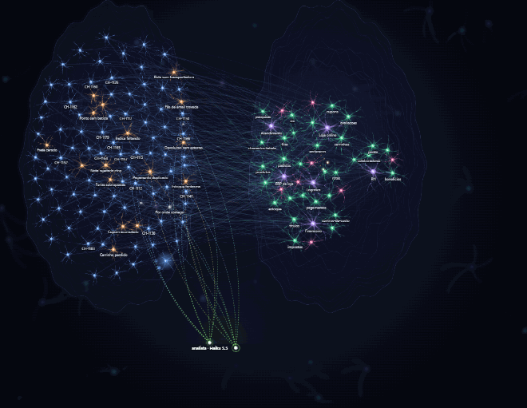
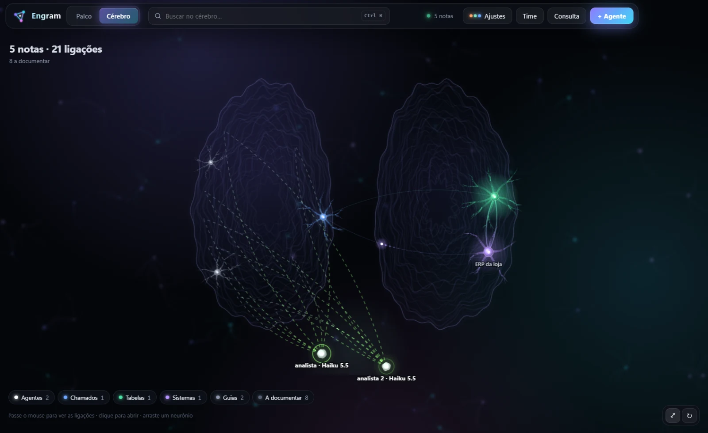
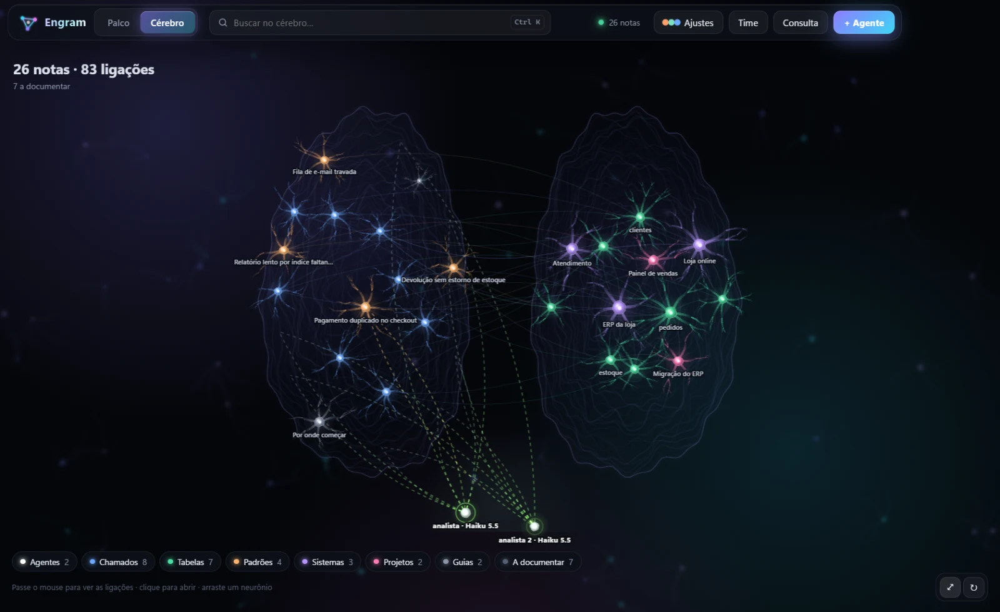
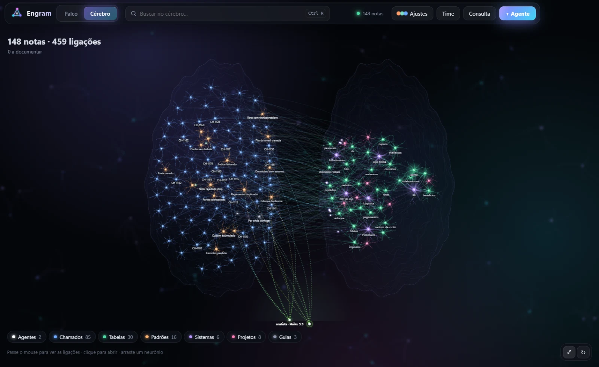
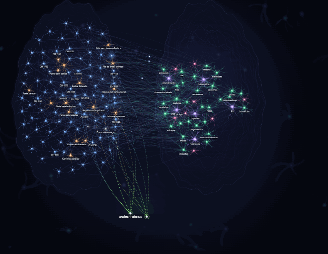

# Engram

**Um time de agentes de IA, trabalhando junto no seu computador.**

Agentes como Claude Code e Codex em cartões num palco, ligados por linhas que você desenha. 
Um maestro divide o trabalho, cada um usa o modelo certo, e o que eles aprendem vai para um cérebro de notas que fica com você.

[**⬇ Baixar para Windows**](https://github.com/nathanfogaca/engram/releases/latest/download/Engram-windows-x64.exe) · [Site](https://nathanfogaca.github.io/engram/) · [Versões](https://github.com/nathanfogaca/engram/releases)

## O que ele faz

| | |
|---|---|
| **Palco de agentes** | Cada agente é um cartão. Arraste uma linha entre dois e eles conversam; as mensagens correm pela linha. Um **maestro** recebe o pedido, delega e junta os resultados. |
| **Vários agentes** | Claude Code e Codex completos, no mesmo time. Gemini CLI e OpenCode como experimentais. Cada janela com o seu modelo. |
| **O time não cai** | Os agentes rodam num motor separado: fechar, reiniciar ou atualizar o app não derruba ninguém, e a conversa continua de onde parou. |
| **Revisão no caminho** | Clique na linha entre dois agentes e escolha quem revisa: tudo o que um entrega passa pelo outro, junto com a tarefa original, antes de chegar a quem pediu. |
| **Código** | O lado "VS Code" do Engram: explorador de arquivos, editor Monaco com abas e comparação de mudanças, git (commit, push, branches, mensagem escrita pela IA), terminais e busca rápida (Ctrl+P). Quando um agente mexe num arquivo aberto, o editor recarrega sozinho. |
| **Extensões** | Temas de cores e de ícones, realce de sintaxe e snippets das extensões do VS Code: pela loja Open VSX, das que você já tem no VS Code ou no Cursor e das que vêm com o VS Code instalado. |
| **Visualizar trabalho** | O olho no cartão do agente abre uma janela à parte para ver o código sendo escrito: as linhas que saem, as que entram sendo digitadas, os arquivos mexidos e a linha do tempo do que ele está fazendo. |
| **Prévias** | Como os artefatos do Claude: páginas HTML rodando de verdade, imagens, vídeo, áudio, PDF, Markdown e CSV, num painel que recarrega sozinho quando o arquivo muda, com versões e tamanhos de tela. |
| **Navegador** | Abra o site que está rodando no seu computador (localhost) dentro do Engram, como computador, tablet ou celular, com os erros do console à vista. Quando um terminal sobe um servidor, o Engram oferece abrir. |
| **IntelliSense** | Servidores de linguagem como no VS Code: o Python (Pyright) ganha autocompletar com tipos, documentação ao passar o mouse, ir para a definição e erros sublinhados. |
| **Fluxos** | O projeto em blocos ligados, no estilo do n8n (tela → rota → tratamento → banco). Uma IA monta o mapa lendo a pasta; os agentes marcam o bloco em que estão mexendo e ele acende na cor de cada um. |
| **Cérebro de notas** | Notas em Markdown ligadas por `[[id]]`, vistas como uma rede de neurônios viva. Os agentes leem antes de investigar e gravam o que aprendem. Fica numa pasta sua. |
| **Conversa legível** | O cartão mostra a conversa em texto, sem gastar token. Leitor grande, arquivos por agente (mande logs e prints; ele devolve o que fez). |
| **MCPs fáceis** | Cadastre, teste, ligue e desligue servidores MCP (HTTP ou programa local), por agente. Traga os que já estão no Claude Code e no Codex. |
| **Skills** | Biblioteca de skills (SKILL.md) com editor e prévia; importe `.zip` ou `.skill`. |
| **Contas e cofre** | Login de cada CLI pela tela; chaves de API e tokens no Gerenciador de Credenciais do Windows. |
| **Temas** | Aurora, Oceano, Brasa, Grafite, Claro e Alto contraste. Troca na hora. |
| **Atualização automática** | Novas versões chegam sozinhas pelo GitHub Releases. |

## O cérebro

Cada nota é um neurônio; ligações viram fibras. Quando um agente lê ou grava uma nota, o impulso corre até ela.

| Primeiro dia (5 notas) | Crescendo (26 notas) | Cheio (148 notas) |
|---|---|---|
|  |  |  |

## Mais do app

<table>
<tr>
<td width="50%"> <b>Cérebro.</b> Passe o mouse e cada neurônio mostra as suas ligações.</td>
<td width="50%"> <b>Leitor.</b> A conversa do maestro com as respostas dos colegas.</td>
</tr>
<tr>
<td> <b>MCPs.</b> Testar a conexão mostra as ferramentas do servidor.</td>
<td> <b>Skills.</b> Editor com prévia ao vivo.</td>
</tr>
<tr>
<td> <b>Novo agente.</b> Agente, modelo, papel e MCPs da janela.</td>
<td> <b>Temas.</b> O palco no tema Claro.</td>
</tr>
</table>

## Instalar

1. Baixe o [**Engram-windows-x64.exe**](https://github.com/nathanfogaca/engram/releases/latest/download/Engram-windows-x64.exe) e rode. Ele instala só para o seu usuário.
2. Se o Windows avisar "editor desconhecido", clique em **Mais informações → Executar assim mesmo** (o instalador ainda não tem certificado de assinatura).
3. Na primeira vez, um guia leva você pelo tema, pelas contas e pelo agente padrão, e abre o primeiro time.

**Requisitos:** Windows 10 ou 11 (64 bits) e pelo menos um agente com conta: [Claude Code](https://claude.com/claude-code) ou [Codex](https://developers.openai.com/codex).
